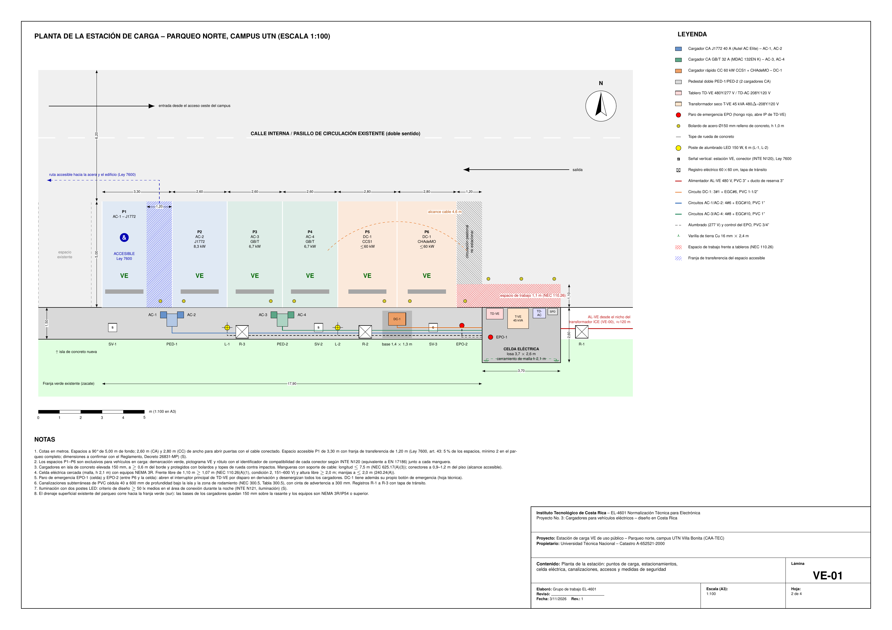

# Estación de carga para vehículos eléctricos — Parqueo norte, campus UTN Villa Bonita (CAA-TEC)

**Estación de carga de uso público con 4 puntos en CA (2 × J1772 de 8,3 kW y 2 × GB/T de 6,7 kW) y un cargador rápido en CC de 60 kW (CCS1 + CHAdeMO), alimentada desde el transformador del ICE N.º 119688.**

Proyecto No. 3 del curso **EL-4601 Normalización Técnica para Electrónica** (Instituto Tecnológico de Costa Rica, II Semestre 2026).

📄 **Informe completo:** [`Informe_Técnico.pdf`](Informe_Técnico.pdf) · 📐 **Láminas:** [`laminas/`](laminas/) · 🧮 **Cálculos:** [`calc/`](calc/) · 🎤 **Presentación oral:** [`presentacion/`](presentacion/)



## Resultados principales

| Parámetro | Valor |
|---|---|
| Puntos de carga | AC-1/AC-2 J1772 40 A · AC-3/AC-4 GB/T 32 A · DC-1 60 kW CCS1 + CHAdeMO |
| Servicio | Nuevo, 480Y/277 V, IP-VE 200 A, medición indirecta propia del ICE |
| Alimentador | 3#3/0 + N#4 + EGC#6 Cu, PVC 3", ≈120 m, caída de 1,54 % |
| Demanda | 94,5 kW sin gestión · 60 kW con EMS (NEC 625.42) |
| Tiempos del 20 al 80 % | Dolphin (CA GB/T) 4 h 32 min · Ioniq 5 en DC-1 48 min · F-150 Lightning en DC-1 1 h 21 min |
| Corriente de falla | 15,7 kA en el transformador · 5,8 kA en TD-VE · 2,8 kA en TD-AC |
| Presupuesto | USD 102 500 (≈ ₡51,8 M), sin IVA |
| Costo de operación | ₡98–139/kWh según la tarifa (T-CS/T-CO) y el EMS |

## Hallazgos que definieron el diseño

- **Ley 10937 (5 jun 2026):** permite que cualquier persona física o jurídica opere centros de recarga y venda el servicio (reforma de los arts. 31–32 de la Ley 9518). Su reglamento y la tarifa de ARESEP siguen pendientes.
- **Reglamento de la Ley 9518 (Decreto 41428):** remite a INTE/IEC 61851-1, -22 y -23.
- **Flota mixta:** el BYD Dolphin de Costa Rica usa **GB/T**; ningún cargador CC con listado UL a 480 V ofrece GB/T. Por eso hay puntos GB/T en CA.
- **Cargo por demanda del ICE:** representa el 42–54 % de la factura, de ahí el EMS de 60 kW.

## Estructura

```
.
├── Informe_Técnico.pdf
├── 00_Enunciado/            Enunciado del proyecto
├── Docs_latex/              Fuente LaTeX (main.tex + una sección por archivo, prompts de IA)
├── calc/                    electrico.py, carga.py, economico.py y sus *_out.txt
├── laminas/                 VE-00 a VE-03 (PDF A3 + PNG); src/ con generadores TikZ y build.sh
├── figuras/                 Imagen satelital (Esri z18/z19) y extractos del P2 (E01, E07)
├── Datasheets/              Fichas de los equipos seleccionados y comparados, BYD Dolphin CR, Decreto 41428
└── presentacion/            Presentación oral (PPTX + PDF) y su generador (src/build_deck.js)
```

| Lámina | Contenido |
|---|---|
| [VE-00](laminas/VE-00.pdf) | Ubicación general sobre la imagen satelital, transformador del ICE y ruta del alimentador |
| [VE-01](laminas/VE-01.pdf) | Planta 1:100: espacios, cargadores, celda eléctrica, canalizaciones, accesos, cotas y leyenda |
| [VE-02](laminas/VE-02.pdf) | Diagrama unifilar desde el transformador hasta cada cargador |
| [VE-03](laminas/VE-03.pdf) | Detalles de montaje, zanja, base de DC-1, puesta a tierra, rotulación y emergencia |

## Cómo reproducir

Requiere Python 3 (sin bibliotecas externas para los cálculos; Pillow solo si se regenera la imagen base), TeX Live con `babel-spanish`, `tikz`, `siunitx`, `standalone`, `fancyvrb`, y `pdftoppm`.

```bash
cd calc && python3 electrico.py > electrico_out.txt && python3 carga.py > carga_out.txt && python3 economico.py > economico_out.txt
cd ../laminas/src && ./build.sh
cd ../.. && pdflatex Docs_latex/main.tex && pdflatex Docs_latex/main.tex   # compilar desde la raíz
```

## Equipo

Walter Alfaro Ulate · Sebastián Meneses Castillo · Thomas Reed Víquez — **Profesor:** Luis Roberto Pereira Arroyo

## Uso de inteligencia artificial

Se usó Claude (Claude Code) como asistente. Los prompts están íntegros en el anexo «Registro de uso de inteligencia artificial» y en [`Docs_latex/prompts_ia_grupo.tex`](Docs_latex/prompts_ia_grupo.tex). Toda la información se verificó contra las fuentes citadas.

## Aviso

Trabajo académico. No sustituye planos firmados por un profesional responsable ante el CFIA, ni el estudio de capacidad del ICE ni los permisos que exige una implementación real.
